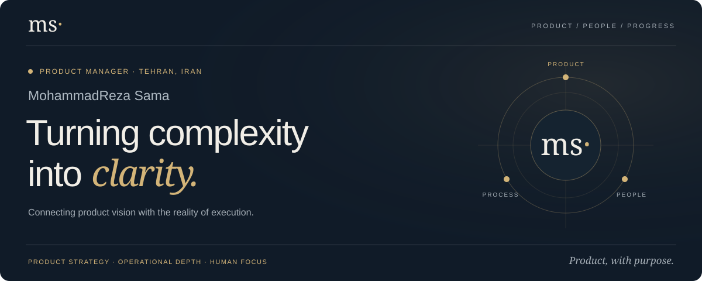
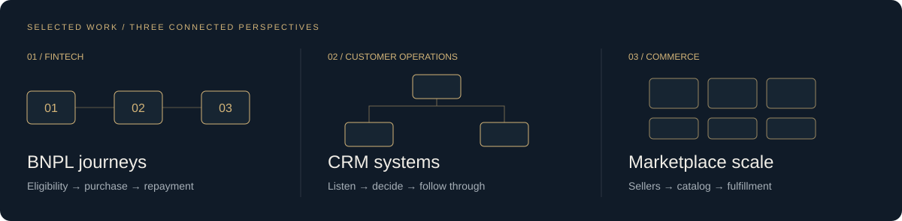

<!-- Brand assets are maintained locally in this repository; no third-party stats widgets. -->

  

  <a href="https://mxowl.github.io/"><strong>Explore my portfolio ↗</strong></a> &nbsp; · &nbsp;
  <a href="https://www.linkedin.com/in/mohammadreza-samavatian-045bb0238">LinkedIn</a> &nbsp; · &nbsp;
  <a href="mailto:mrezasmvt@gmail.com">Let’s talk</a> &nbsp; · &nbsp;
  <a href="https://mxowl.github.io/resume-en.pdf">English résumé ↓</a> &nbsp; · &nbsp;
  <a href="https://mxowl.github.io/resume-fa.pdf">رزومه فارسی ↓</a>

### 01 / THE HUMAN SIDE

I’m **MohammadReza Sama**, a Product Manager at **TalaLand**, with a foundation in customer experience and operations at **SnappMarket**.

I connect product vision with the reality of execution—from the first customer signal to the roadmap, release, and what comes next. My work spans **BNPL, CRM, marketplaces, payments, and last-mile operations**.

> A good product should make sense to the customer—and work for the people delivering it.

### 02 / SELECTED WORK

| Focus | What I work on |
| :--- | :--- |
| **BNPL & installment gold purchase** | End-to-end customer journeys, business rules, exception paths, and acceptance criteria. |
| **CRM action plan & knowledge tree** | Decision trees, scripts, escalation rules, follow-up ownership, and team enablement. |
| **Marketplace expansion** | Seller readiness, catalog structure, pricing, inventory, and fulfillment requirements. |
| **Dashboard & analytics** | Connecting sales, conversion, retention, CRM, and data quality to decisions. |
| **Product & technical delivery** | Prioritization, user stories, API/webhook requirements, QA, and release readiness. |
| **CRM scale & unified back-office** | Standardized workflows, KPI/SLA monitoring, automation roadmaps, and provider coordination. |

**[Explore the project spotlights in my portfolio ↗](https://mxowl.github.io/#work)**

These are summaries of professional experience. The portfolio provides context; internal systems and company source code are not published here.

### 03 / HOW I WORK

**Understand → Design → Align & deliver → Measure & learn**

Customer signals and evidence first. Then clear flows, explicit trade-offs, shared priorities, and a next step the team can act on.

| Product & delivery | Operations & experience | Data & collaboration |
| :--- | :--- | :--- |
| Roadmaps · Prioritization | CRM · Customer journeys | Power BI · Excel |
| User stories · Acceptance criteria | SOPs · KPI / SLA | Google Sheets · Reporting |
| Jira · Figma · Agile / Kanban | BNPL · Marketplace · Fulfillment | API / Webhooks · QA · AI-assisted prototypes |

### 04 / THE JOURNEY

- **TalaLand · Product Manager** — March 2026–present  
  Product direction, prioritization, and delivery across customer and operational systems.
- **TalaLand · Business Process & Operations Lead** — November 2025–February 2026  
  Operational flows, CRM knowledge systems, reporting, and team enablement.
- **SnappMarket · Customer experience & operations** — July 2023–November 2025  
  VOC Specialist → Operations Expert → Operations Incharge.

[More about my experience, education, and professional learning ↗](https://mxowl.github.io/#experience)

<strong>فارسی / دربارهٔ من</strong>

### محمدرضا سماواتیان | سما

مدیر محصول در **طلالند**، با تجربهٔ صدای مشتری، عملیات و راهبری تیم در **اسنپ‌مارکت**.

چشم‌انداز محصول را به واقعیت اجرا وصل می‌کنم؛ از اولین نشانه در صدای مشتری تا نقشهٔ راه، انتشار و یادگیری از نتیجه. حوزهٔ کار من شامل خرید اعتباری، CRM، مارکت‌پلیس، پرداخت و تحویل نهایی است.

**محصول × فرآیند × آدم‌ها**

[پورتفولیوی دوزبانه](https://mxowl.github.io/) · [رزومهٔ فارسی](https://mxowl.github.io/resume-fa.pdf) · [گفت‌وگو](mailto:mrezasmvt@gmail.com)

 

MohammadReza Sama · <em>Product, with purpose.</em>

